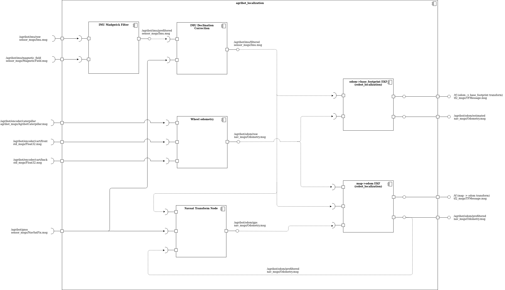

# Component diagram

# Detailed documentation
- [Configuring location on Earth in a simulation](doc/configuring_earth_location/README.md)
- [Inclination, declination and reference heading](doc/inclination_declination_reference_heading/README.md)
- [Frames convention](doc/frames_convention/README.md)