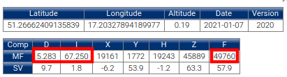

# Configuring location on Earth in a simulation
`NOTE` - **More technical information on parameters set in this tutorial can be found in [Inclination, declination and reference heading](../inclination_declination_reference_heading/README.md) document**

### To configure the simulation for the new location on the Earth, the following reference parameters must be set in [simulation/config.bash](https://bitbucket.org/agribotteam/agribot_configs/src/master/simulation/config.bash):
- `AGRIBOT_SIMULATION_LATITUDE`
- `AGRIBOT_SIMULATION_LONGITUDE`
- `AGRIBOT_SIMULATION_ALTITUDE`
- `AGRIBOT_SIMULATION_HEADING`
- `AGRIBOT_SIMULATION_DECLINATION`

### Also, it is recommended to set the following parameters, but simulation should work fine even with the default values left unchanged (as it influences magnetic field vector, but shouldn't affect yaw angle resulting from the sensor fusion)
- `AGRIBOT_SIMULATION_INCLINATION`
- `AGRIBOT_SIMULATION_MAGNETOMETER_MAGNITUDE`

---

### To configure the simulation for the new location on the Earth, the following steps should be followed:

1. In [simulation/config.bash](https://bitbucket.org/agribotteam/agribot_configs/src/master/simulation/config.bash) specify `AGRIBOT_SIMULATION_LATITUDE`, `AGRIBOT_SIMULATION_LONGITUDE` and `AGRIBOT_SIMULATION_ALTITUDE` for the selected location (altitude can be checked e.g. in Google Earth)
2. In basic_sensors.xacro specify `AGRIBOT_SIMULATION_HEADING` (according to the convention explained in [Inclination, declination and reference heading](../inclination_declination_reference_heading/README.md) document) to choose robot's starting orientation.
3. Go to e.g. [British Geological Survey](https://geomag.bgs.ac.uk/data_service/models_compass/wmm_calc.html), input latitude, longitude and altitude information. The resulting table contains information about declination (**D**), inclination (**I**) and magnitude (**F**). **MF** (Main Field) part of the table is interesting for us in this case. 
>> * Declination and inclination from the table are correction values, while inclination and declination settings in the plugin mean value to be added to simulate this error, **therefore inclination and declination values specified in simulation/config.bash should be opposite of the values read from the table.**
>> * Magnitude in the table is specified in nanoteslas and should be coverted to Teslas before inputting in basic_sensors.xacro

>> For example, given the following table the settings in simulation/config.bash should be:
>> * export AGRIBOT_SIMULATION_DECLINATION="-5.283"
>> * export AGRIBOT_SIMULATION_INCLINATION="-67.25"
>> * export AGRIBOT_SIMULATION_MAGNETOMETER_MAGNITUDE="4.976e-5"

>> 
