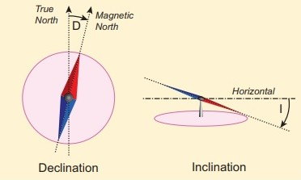
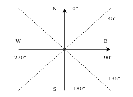
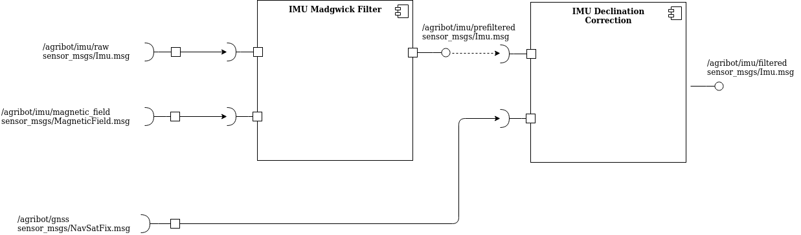

# Theory
>> 

* `Magnetic declination` - the angle on the horizontal plane between magnetic north and true (geographical) north. This is due to the different positions of the geographic and magnetic poles. Declination angle varies depending on position on the Earth's surface and changes over time.

* `Magnetic inclination (dip angle)` - the angle between the horizon plane and the magnetic field vector

* Both declination and inclination corrections are usually based on the [WMM (World Magnetic Model)](https://www.ngdc.noaa.gov/geomag/WMM) and can be obtained from special services like [NOAA National Centers for Environmental Information](https://www.ngdc.noaa.gov/geomag/calculators/magcalc.shtml#declination) or [British Geological Survey](https://geomag.bgs.ac.uk/data_service/models_compass/wmm_calc.html) or using offline libraries - e.g. [geomag](https://github.com/cmweiss/geomag) for Python. The WMM model is issued for five-year periods. It is important to use the latest version of model coefficients (for 2020-2025).

* Typically for IMU/AHRS sensor fusion filters (e.g. Madgwick Filter), when 9DoF IMU is used, inclination correction is not required as there is an additional source of inclination data (accelerometer). However, it is necessary to apply declination correction, because there is no other source of heading data than a magnetometer.

# Practice
## Simulating sensors in Gazebo
### Setting reference heading in Gazebo
* GPS and magnetometer plugins in Gazebo have `AGRIBOT_SIMULATION_HEADING` parameter ([simulation/config.bash](https://bitbucket.org/agribotteam/agribot_configs/src/master/simulation/config.bash)), which describes geographic heading of gazebo frame's x axis, expressed in degrees according to the convention shown in the figure below.
>> 

* It is worth noting that `AGRIBOT_SIMULATION_HEADING` does not conform to [REP-103](https://www.ros.org/reps/rep-0103.html) convention used in the rest of the system (e.g. Madgwick filter or robot_localization) where ENU (x **E**ast, y **N**orth, z **U**p) coordinates are used (ENU frame is explained in the [frames convention](../frames_convention/README.md) document)

### Simulating inclination/declination errors and magnetic field magnitude in Gazebo
* Magnetometer plugin has `AGRIBOT_SIMULATION_DECLINATION` and `AGRIBOT_SIMULATION_INCLINATION` parameters, expressed in degress. These are values added to the geographic direction to simulate inclination and declination errors that would affect real-life magnetometer or compass.

* Magnetometer plugin has `AGRIBOT_SIMULATION_MAGNETOMETER_MAGNITUDE` parameter, expressed in Teslas. This value refers to the magnitude of the magnetic field. It differs for different locations on the earth - exact value can be found e.g. on [NOAA National Centers for Environmental Information](https://www.ngdc.noaa.gov/geomag/calculators/magcalc.shtml#igrfwmm). Incorrect value of this parameter does not affect orientation reported by Madgwick Filter as it only changes scale of magnetic field vector, not its direction. Therefore, if magnetic field vector (`/agribot/magnetic_field`) is not needed anywhere else, this value can remain the default.

* Declination, inclination and magnitude should be configured depending on location on earth where robot operates. Configuration of these parameters for a given location is explained in **[configuring location on Earth in a simulation](../configuring_earth_location/README.md)** tutorial.

---

## Implementation in the localization system
### Correcting declination errors
* Setting `magnetic_declination_radians` in navsat_transform_node from robot_localization([navsat_transform.launch file](../../launch/navsat_transform.launch))) should correct declination errors, however from my observation it only influences `map => utm` transform and is not properly propagated to the local coordinates (in mapviz robot is pointing towards magnetic north instead of geographical north when `AGRIBOT_SIMULATION_HEADING`=0).

* Correction is instead applied using ([imu_declination_correction_node](../../scripts/imu_declination_correction_node.py)), which is based on fork of [geomag](https://github.com/cmweiss/geomag) library. The correction is determined for current GPS coordinates obtained from `/agribot/gnss` topic. Correction is then applied according to the diagram presented below - declination angle is added to the yaw angle of `sensor_msgs/Imu` message from the `/agribot/imu/prefiltered` topic. The corrected message is then rewritten to the `/agribot/imu/filtered` topic. Thanks to this, robot_localization nodes receive messages with the already corrected declination error.
>> 

* `*** IMPORTANT NOTE ***` - It will be necessary to replace [WMM.COF](https://bitbucket.org/agribotteam/agribot_configs/src/master/base/localization/WMM.COF) file around 2024/2025 when coefficients for the new model will be released
